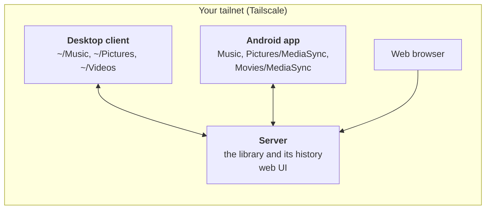

# MediaSync

Self-hosted version control for your music, photos and videos. One PC holds the library; your
other PCs and your Android phone keep copies of it in sync. Every change (a retag, a rename, a
deleted file) is a revision you can look at and undo, and nothing changes on a device until you've
seen what's coming.

- **Music is filed by its tags**: `Artist/Album/01 Title.flac`, on every device. Fix a tag in the web
  UI and the file is renamed and retagged everywhere.
- **Tags are versioned apart from the audio.** A retag only sends the new tags, never the whole
  file again. Tags you don't want (ripper comments and the like) are stripped, and the server keeps
  the originals.
- **Photos are filed by year** (`2019/2019-07-14 IMG_1234.jpg`), dated from the camera's EXIF data
  or the file name. **Videos** are filed as movies or show episodes, and a device can keep only the
  ones you pick for it.
- **A web UI** for browsing the library, editing tags, dating photos, tidying a messy collection,
  going through the history and managing devices.
- **Private by design.** It runs only on your own machines and is reached over your own
  [Tailscale](https://tailscale.com) network (a "tailnet"), never the open internet.

## How it works



- **The server** runs on a Linux PC that's usually on. It holds the repository: each file's content
  once, the tags and other details of every file, and the history of every change. It also serves
  the web UI.
- **Devices** (the desktop client and the Android app) pair with the server once, using a code or
  QR code from the web UI. Each device syncs some of the library's top-level folders
  (`music/`, `photos/`, `videos/`) with folders of its own, either both ways, receive-only or
  send-only.
- **Syncing asks first.** Every hour each device scans its folders and asks the server what
  changed, without changing anything. When something is waiting, it notifies you. You then accept
  each change, or undo it, or revert it on the server. You can turn asking off on a device so it
  syncs on its own.
- **Nothing is lost.** Every change is a revision, and reverting one makes a new revision.
  Deleted files stay in the repository until you prune old history. Large deletions (an unmounted
  disk, a wiped folder) are held back until you confirm them.

## What you need

| | Requirement |
| --- | --- |
| **The server** | A Linux PC with systemd (Debian, Ubuntu, Fedora, …) that's on whenever you want to sync, with room for the library. Java 17 or newer and Python 3. |
| **Tailscale** | Installed and logged in on the server and on every device, all in the same tailnet (the free plan is plenty). |
| **Desktop client** (optional) | Linux with systemd, x86_64 for the ready-made download. The tray icon needs KDE Plasma, or GNOME with the AppIndicator extension; notifications work on any desktop. |
| **Android app** (optional) | Android 13 or newer, with the Tailscale app. |

Windows and macOS aren't supported.

## Setup

These steps take about 15 minutes, plus the first upload of your library.

### 1. Tailscale

1. [Install Tailscale](https://tailscale.com/download) on the server PC, your other PCs and your
   phone. Log in with the same account on all of them.
2. In the [Tailscale admin console](https://login.tailscale.com/admin/dns), go to **DNS** and make
   sure **MagicDNS** and **HTTPS Certificates** are both turned on. The server uses them to get an
   `https://` address such as `https://my-pc.tail1234.ts.net:8443`.

### 2. The server

**From a release** (no build needed): from the
[Releases page](https://github.com/tblisonb/MediaSync/releases), download the newest
`mediasync-server-<version>.tar.gz`, then:

```sh
sudo apt install openjdk-21-jre-headless python3       # or your distribution's equivalent
tar xzf mediasync-server-<version>.tar.gz
sudo mediasync-server-<version>/install.sh
```

**Or from source:** this needs a JDK (`sudo apt install openjdk-21-jdk-headless git`).

```sh
git clone https://github.com/tblisonb/MediaSync.git && cd MediaSync
scripts/update.sh server
```

The first install:

- creates a `mediasync` system user and the repository in `/var/lib/mediasync`. To keep it
  somewhere else, such as a bigger disk, add `--repo /mnt/disk/mediasync` to the install command
  (or to `deploy/install.sh` from source). The folder can't be inside a home folder.
- asks for an **admin password**, which you'll use to log in to the web UI.
- asks for the **music tag policy**: the tags kept in your music files. Every other tag is removed
  from the files, but the server keeps the originals. The suggested list suits most libraries, and
  you can change it later in the web UI's Settings.
- starts the service and publishes it on your tailnet. It ends by printing the address, for
  example `https://my-pc.tail1234.ts.net:8443`.

Open that address in a browser on any of your devices and log in. If the script says other devices
can't reach the server yet, it says why (usually Tailscale isn't connected, or HTTPS certificates
are off). Fix that and run the script again.

The service is locked down: it can only reach the network over localhost (Tailscale forwards to
it), and it can only write to its repository.

### 3. The desktop client

On each Linux PC whose files you want in the library, including the server PC if your music lives
there:

**From a release:** download `mediasync-desktop-<version>-linux-x86_64.tar.gz`. It includes its own
Java. Then:

```sh
tar xzf mediasync-desktop-<version>-linux-x86_64.tar.gz
mediasync-desktop-<version>-linux-x86_64/install.sh     # no sudo: it installs for you only
```

**Or from source**, in the cloned repository: `scripts/update.sh desktop`.

The installer asks:

1. **Server URL**: the address the server install printed.
2. **Pairing code**: in the web UI, go to **Devices > Pair a device** and copy the code.
3. **A name** for this PC, and its **music folder** (`~/Music` by default).
4. **Sync mode**: `two-way` (the default), `receive-only` (just get the library) or `send-only`.

It then **previews the first sync**: which files will be renamed and which tags will be removed.
Nothing has changed yet at this point. Sync starts only if you answer yes. If your music is precious and has
never been tidied, back it up first. The server keeps the original tags, but a backup is cheap
peace of mind.

The client runs as a user service that starts with your desktop session. An icon in the system
tray shows when something is waiting.

The first PC you set up fills the library, so set up the PC with your music on it first. If
`mediasync-desktop` isn't found, add `~/.local/bin` to your `PATH`.

### 4. The Android app

1. Make sure the Tailscale app is connected on the phone.
2. From the Releases page, download `mediasync-<version>.apk` on the phone and open it. Android asks
   you to allow installing apps from your browser or file manager the first time.
3. Open MediaSync and allow **All files access** (it needs it to manage your Music folder).
4. In the web UI, go to **Devices > Pair a device** and scan the QR code with the app. You can
   also type in the server address and the code.
5. The app previews what the first sync does to the phone's `Music` folder. It starts when you tap
   **Start syncing**.

### 5. Photos and videos (optional)

Music is synced from the start. Photos and videos are separate folders you add on each device:

```sh
mediasync-desktop add-folder photos/ ~/Pictures                  # every photo, filed by year
mediasync-desktop add-folder videos/ ~/Videos                    # every video
mediasync-desktop add-folder videos/ ~/Videos --pick             # only the videos picked for this PC
```

On the phone, turn on **Photos** (kept in `Pictures/MediaSync`) or **Videos** (`Movies/MediaSync`,
only the videos you pick) on the main screen. The rest of the phone's pictures, such as the
camera's own folder, are left alone.

## Using it

### Reviewing changes

When a device finds changes, it notifies you. On a PC, click the notification or the tray icon,
or run `mediasync-desktop review`. On the phone, open the app.

- **Changes from the server** are grouped by revision. You can **Accept** them, or **Revert on the
  server** to undo them for every device.
- **Changes made on this device** are grouped by kind (new, edited, deleted). You can **Accept** them,
  which sends them to the server, or **Undo here**, which puts the files back as they were.
- Anything you leave waits for the next check.

To sync without being asked, turn asking off on the review page (on the phone, the **Ask before
syncing** switch). A PC
then syncs about 10 seconds after files stop changing, and within a second or two of a change
from elsewhere. The phone syncs every 15 minutes on Wi-Fi, and whenever you open it.

### The web UI

- **Library**: browse the folders. Each album has a tag editor (**Edit this album's tags**). Each
  video folder has **Edit these videos' details**, and each photo folder has **Date these photos**.
- **History**: every revision, with what it changed. You can revert a whole revision or restore
  a single field.
- **Resolve**: conflicts, such as the same tag edited differently on two devices, wait here for
  you to choose.
- **Cleanup**: helps with a messy library.
  - Finds artist and album names spelled several ways.
  - Moves stray cover scans to their album.
  - Lists albums with missing tags.
  - Deletes leftover files (`desktop.ini`, `Thumbs.db`, …).
  - Tidies album art.
  - Converts tracks to MP3 (WMA, AAC `.m4a`, FLAC, Ogg…), so every device has one format. It can
    also keep converting tracks in those formats as they're added. Tracks keep their tags, cover
    and place, and devices swap their copies for the MP3s at their next sync. Needs `ffmpeg` on
    the server.
  - Each cleanup is one revision, so it can be reverted.
- **Devices**: pair and revoke devices, and see which folders each one syncs.
- **Settings**: the tag policy.

### Music

Tracks are filed as `music/{album artist}/{album}/{track} {title}`, using the disc number too for
multi-disc albums. A file renamed by hand moves back. Files whose tags MediaSync can't manage
(Opus, WAV, `.cue`, cover scans) sync as they are, where they are. Windows and macOS clutter
(`desktop.ini`, `Thumbs.db`, `.DS_Store`) is never synced. Once Cleanup marks it for removal, each
device deletes its own copies.

### Photos

A photo has a date: a year, a month or a day (`2019`, `2019-07` or `2019-07-14`). Photos are filed
as `photos/{year}/{date} {name}`, or as `photos/Undated/{name}` until they have a date. Anything
else you keep in `photos/` stays where it is.

The date comes from the camera (EXIF data, or a video's creation time) or, failing that, from the
file name (`IMG_20240714_…`, `PXL_…`, `Screenshot_…`, WhatsApp's `IMG-20240714-WA…`).

To fix dates, go to Library > a folder in `photos/` > **Date these photos**. Tick some
thumbnails, type a date, and they move. The date is stored in MediaSync, so your photo files are
never modified.

### Videos

Movies and episodes have their own details (title, year, show, season and episode), guessed from
the file name when they're added.

- Movies are filed as `videos/movies/Title (Year)/Title (Year)`.
- Episodes are filed as `videos/shows/Show/Season NN/Show - SnnEnn - Title`.
- Other videos keep their path.
- Subtitles (`{video}.en.srt`) and posters (`{video}-poster.jpg`) sit beside their video and
  follow it when it moves.

On a device set to `--pick`, only the videos you pick are kept. You pick them on a video's page or
for a whole folder in the web UI, or under Videos > Choose videos… on the phone.

### The desktop client's commands

```sh
mediasync-desktop status          # the server, the folders, and what's waiting
mediasync-desktop review          # the review page, in the browser
mediasync-desktop check           # look for changes now
mediasync-desktop sync            # sync everything now, without asking
mediasync-desktop log | diff <rev> | revert <rev>
mediasync-desktop open            # the web UI
mediasync-desktop help            # everything else
```

The tray icon is highlighted when something is waiting, or when syncs keep failing. Clicking it
opens the review page, and a middle click checks now.

The config is in `~/.config/mediasync/` and the client's state in `~/.local/state/mediasync/`. The
service can only write to the folders it syncs and to its own state.

### Safety nets

- If more than 20 files (and over 10% of them) disappear at once, or the server asks a device
  to delete that many, the deletion waits until you run `mediasync-desktop sync --allow-deletes`.
- A missing folder, such as an unmounted disk, is never treated as deleted files.
- A second copy of a track that's already in the library is left alone and reported.

## Updating

Update the server first, then the clients: a client may need something only a newer server has.

- **From releases:** download the newer tarball and run its `install.sh` again, the same way you
  installed it. Your repository, settings and pairing are kept. On the phone, install the newer
  APK over the old one.
- **From source:** `git pull`, then `scripts/update.sh`. That updates the server (asking for your
  password), then the desktop client. Use `scripts/update.sh desktop` on PCs without the server.

The APKs on the Releases page (from 0.5.0 on) are release builds, all signed with MediaSync's
release key, so each one installs over the last. If you build the app yourself, your build is signed
with your own key. Android won't install it over the released app (or the other way round) until you
uninstall the old one, and that loses the app's pairing. The same goes once for anyone moving from
0.4.0 or earlier, which were signed with a development key: uninstall, install 0.5.0, then pair again.
Your music stays on the phone, and the first sync finds it already in place.

## Backups and maintenance

The repository holds the only copy of your history, so it's worth backing up. Backups are
optional. The scripts are in `backup/` in the server's release folder, or `deploy/backup/` in the
source. They set up nightly [restic](https://restic.net) backups, with a weekly `restic check` that
reads back a sample. restic encrypts the backups with a password the setup creates. Save that
password in your password manager when it's shown: without it the backups can't be read.
[KEYS.md](KEYS.md) lists exactly what to save, and how to restore the server from a backup.

**To another machine** on your tailnet (recommended). This can be any Linux machine with systemd,
such as a Raspberry Pi, a NAS or an old PC. It runs restic's rest-server in append-only mode, so
nothing on the server, not even a mistake or malware, can delete or rewrite old backups.

1. On the server: `sudo backup/install.sh --target <the machine's tailnet name>`. It creates the
   backup's password, and a login for the machine in `/etc/mediasync/backup.htpasswd`.
2. Copy the `backup/` folder and that htpasswd file to the machine, then run there:
   `sudo bash target-setup.sh --path /mnt/backup/mediasync backup.htpasswd`. Choose any folder
   for `--path`, ideally on its own drive: when the drive isn't mounted, backups stop rather than
   filling the system disk. The machine publishes the backups on port 443. If that port is taken,
   add `--https-port 8444` here, and `--port 8444` on the server in the next step.
3. On the server, run step 1 again. It creates the backup repository and starts the timers.

**To a folder on the server**, on another drive: `sudo backup/install.sh --local /mnt/usb/mediasync-backup`.
This is simpler, but the backup isn't append-only, and it's lost along with the server PC if
something happens to the PC (theft, fire).

Back up now with `sudo systemctl start --no-block mediasync-backup`, and follow along with
`journalctl -fu mediasync-backup`. To move the backups somewhere else, remove
`/etc/mediasync/backup/repository` and set them up again.

Maintenance commands run as the service's user:

```sh
sudo -u mediasync /opt/mediasync/bin/mediasync-server fsck --full --repo /var/lib/mediasync   # check every file
sudo -u mediasync /opt/mediasync/bin/mediasync-server prune --older-than 1y --repo /var/lib/mediasync
sudo -u mediasync /opt/mediasync/bin/mediasync-server pair-code --repo /var/lib/mediasync     # a pairing code without the web UI
sudo -u mediasync /opt/mediasync/bin/mediasync-server setup --repo /var/lib/mediasync         # change the admin password
```

`prune` drops the history older than that (keeping each file's latest version) and files deleted
before then, so those can no longer be restored.

## Troubleshooting

- **A device can't reach the server.** Check that Tailscale is connected on both machines.
  `tailscale serve status` on the server should list port 8443. Run `deploy/smoke-test.sh <server
  URL> <pairing code>` to test the server from another PC. It pairs a test device (revoke it
  afterwards) and never changes the library.
- **Server logs:** `journalctl -u mediasync`. **Desktop client logs:**
  `journalctl --user -u mediasync-desktop -f`.
- **The desktop client says it isn't running:** `systemctl --user enable --now mediasync-desktop`.
- **A sync is held back** because of many deletions: look at `mediasync-desktop status`. If the
  deletions are real, run `mediasync-desktop sync --allow-deletes`.

## Development

MediaSync is Kotlin throughout, built with Gradle.

| Module | What |
| --- | --- |
| `shared/` | Plain Kotlin used everywhere: media hashing (`media/`), tag reading and writing with jaudiotagger (`tags/`), the sync API types (`api/`), tag policy, path rules, subscriptions and the three-way merge (`library/`), and the sync engine both clients run (`sync/`) |
| `server/` | Ktor server: repository, sync API, web UI, and the `setup`, `fsck`, `prune` and `snapshot` commands |
| `desktop/` | Desktop client: a systemd user service, the review page, tray icon, notifications and the CLI |
| `app/` | Android app (Jetpack Compose and WorkManager) |
| `spike/` | The first tag round-trip check (see [MILESTONES.md](MILESTONES.md)) |
| `deploy/` | The server's systemd unit, install script, backups and an end-to-end smoke test |
| `scripts/` | `update.sh` (build and install), `release.sh`, `make-release-key.sh`, `make-fixtures.sh` |

Every script explains itself with `--help` (or `-h`), as do `mediasync-server --help` and
`mediasync-desktop --help`.

**Toolchain.**
- **JDK:** any JDK 21 builds the server and the desktop client. Set `JAVA_HOME`, or install
  `openjdk-21-jdk-headless`. `scripts/update.sh` also finds one in `~/Android/jdk-21`.
- **Android SDK:** the app also needs it, found through `ANDROID_HOME` or `sdk.dir` in
  `local.properties`. Without it, Gradle simply leaves the `:app` module out.

```sh
./gradlew :shared:test :server:test :desktop:test   # the desktop tests run two clients against a real server
./gradlew :app:installDebug                         # onto a phone over USB, or paired with adb pair / adb connect
./gradlew connectedDebugAndroidTest                 # tag round trip and file handling, on the phone
./gradlew :desktop:bundledDist                      # the self-contained desktop tarball
```

The sync API is under `/api/v1` (types in `shared/.../api/Api.kt`).
`server/src/test/.../TestDevice.kt` is a scripted client that shows how a device drives it.

**Releases.** Each part is versioned and released on its own from master, as a tag and a GitHub
release with its build attached: `app-v…` (the APK), `desktop-v…` (the self-contained tarball) and
`server-v…` (the server tarball, which installs itself). To release a part:

1. Bump its version in its `build.gradle.kts` (for the app, `versionCode` too).
2. Push.
3. Run `scripts/release.sh app` (or `desktop`, or `server`).

The script runs that part's tests first, and refuses a version that's already tagged.

The APK is a release build, signed with the release key from `~/.android/mediasync-release.jks`,
whose password is in `~/.android/mediasync-release.properties`. `scripts/make-release-key.sh` made
that key once; it refuses to replace an existing one. Keep a copy of both files somewhere safe,
as [KEYS.md](KEYS.md) describes.
Losing them means every phone has to uninstall the app to take a new release. Anyone who has
them can sign an update your phones would accept.

How MediaSync got here, milestone by milestone, is in [MILESTONES.md](MILESTONES.md).
